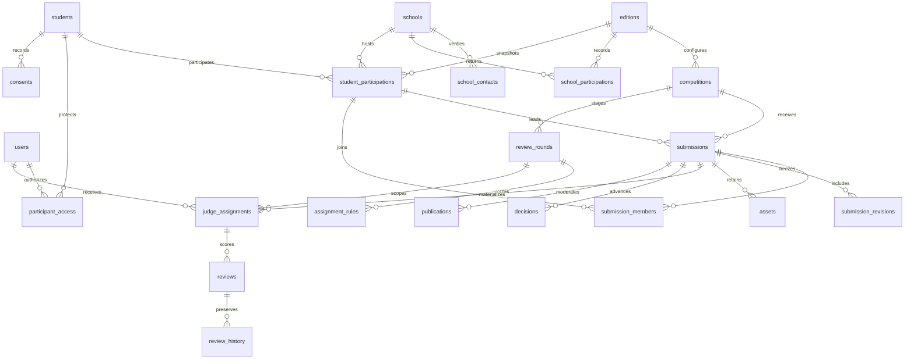

# Data relationships

School and student references identify records; authorization comes from authenticated users and explicit access rows. School contacts are verified separately. Edition participation stores snapshots; contact changes do not rewrite historic submitted revisions.

Submission state, asset verification state and review status are separate columns. A final revision contains its answers, context, form configuration and exact asset IDs. Reviews carry the assignment, revision and rubric version. An explicitly revoked assignment remains excluded from automatic routing. Reopening an entry invalidates otherwise-active assignments separately: resubmission can advance those assignments to the new revision without erasing earlier reviews or reviving explicit exclusions.

Jury rounds declare prerequisite scoring round IDs from the same competition. Every listed round must have the configured minimum distinct reviewers' eligible, submitted reviews for the current revision. No default aggregation or automatic winner selection is supplied. Publications retain their own moderated selection of the submitted file IDs; recovering a discarded draft file never adds it to a submitted or public selection.

Core domain relationships use restrictive foreign keys. Ordinary deletion changes Trash metadata. A deletion batch lists exactly the records it moved; restoring it does not affect records trashed by other operations. Purge removes content only through a tracked worker after private storage deletion. A minimal purge ledger is retained for recovery reconciliation.

PostgreSQL stores structured searchable fields and validated JSONB for configurable forms/rubrics. Annual participation, references, assignment identity, revision identity and import source identity have uniqueness constraints. Submission uses ordered participation row locks to serialize entry-limit checks across concurrent entries and teams.
